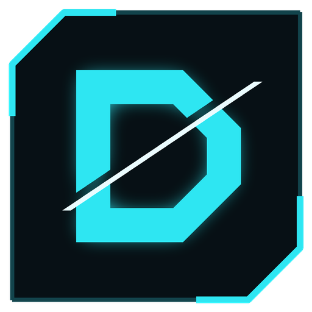
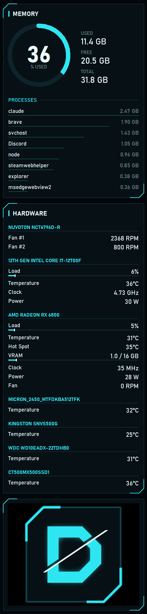
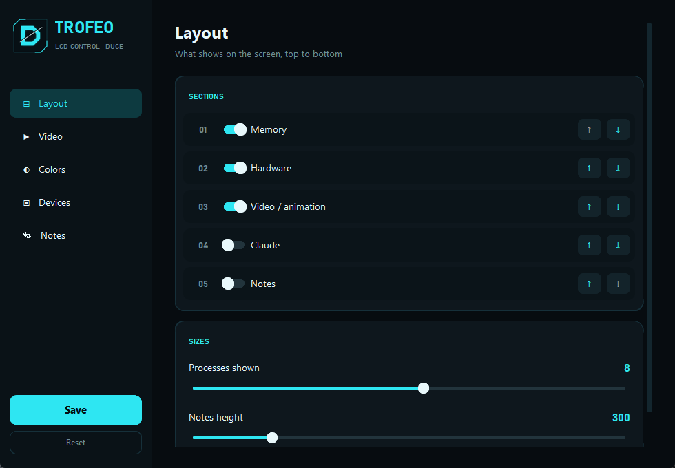
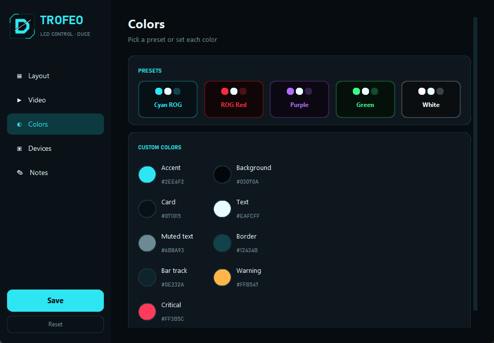
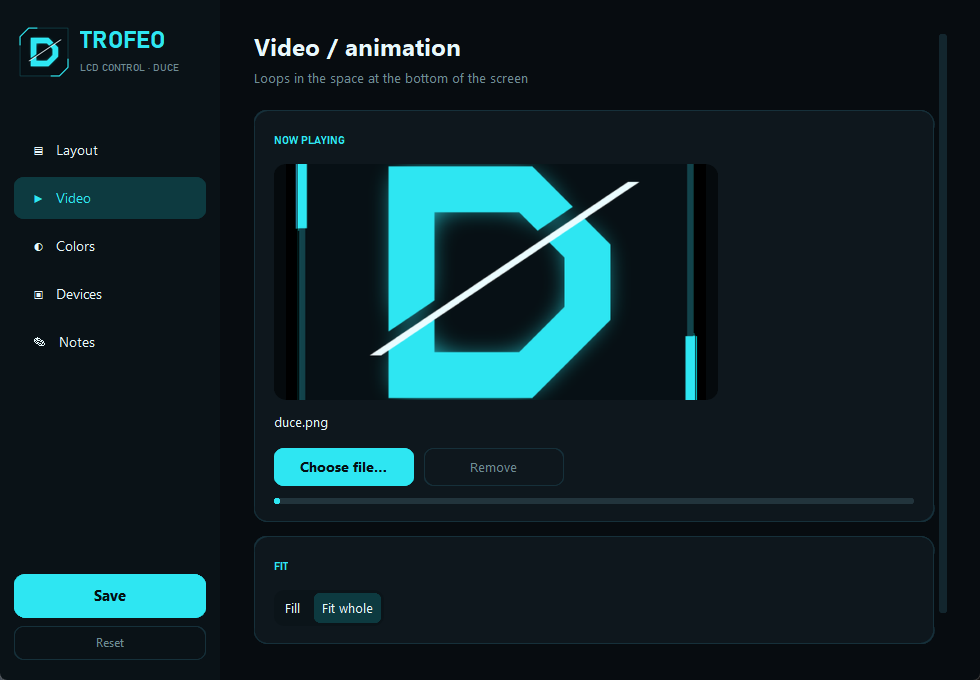
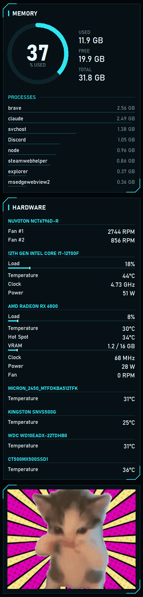

<p align="center">
  
</p>

<h1 align="center">Trofeo LCD Control</h1>

<p align="center">
  Turn the <b>Thermalright Trofeo Vision 9.16"</b> case screen into a real Windows extended display<br>
  with a live hardware dashboard, looping video and a settings app — no TRCC required.
</p>

<p align="center">
  
  
  
</p>

---

## What it does

| Dashboard on the LCD | Settings app |
|---|---|
|  | <br><br> |

- **Extended display** — the 1920×462 panel shows up in Windows like any monitor. Drag windows onto it, or let the dashboard fill it.
- **Vertical or horizontal mounting** — follows the orientation you set in Windows display settings (portrait 462×1920 or landscape 1920×462).
- **Live dashboard**
  - **Memory**: usage ring, used / free / total, and the processes using the most RAM.
  - **Hardware**: CPU, GPU, disks and fans in the style of HWMonitor (load, temperature, clock, power, VRAM, RPM). Powered by LibreHardwareMonitor.
  - **Video / animation**: any MP4, MOV, MKV, WEBM, GIF or image loops in the space that's left. Large videos (even 4K) are shrunk once so playback stays light.
  - Optional **Claude Code** usage card and a free-text **Notes** card.
- **Settings app** — toggle and reorder sections, change the video, pick a color preset (Cyan ROG, ROG Red, Purple, Green, White) or set every color yourself, hide devices, write notes. Changes reach the LCD within 2 seconds.
- **One file to share** — `TrofeoLCD.exe` installs itself, starts with Windows and can uninstall itself.

The default look is a near-black, cyan-accented theme with chamfered cards, made to match a white ROG build with ice-blue fans.

<p align="center">
  <br>
  <sub>Live capture of the LCD — vertical mount, with a looping video in the bottom area.</sub>
</p>

## Requirements

- Windows 10 or 11 (64-bit)
- Thermalright **Trofeo Vision 9.16"** LCD — USB ID `0416:5408`
- The screen's **WinUSB driver**. It comes with Thermalright's TRCC software: install TRCC once (you don't need to keep it running). Without TRCC you can install WinUSB for the device with [Zadig](https://zadig.akeo.ie/).

## Install

1. Download **`TrofeoLCD.exe`** from the [Releases](../../releases) page.
2. Double-click it and wait 10–15 seconds (it unpacks itself first).
   - If Windows SmartScreen says *"Windows protected your PC"*, click **More info → Run anyway** (the exe isn't code-signed).
   - If nothing happens on the very first run, start it once more — antivirus sometimes holds a brand-new exe for a moment.
3. Accept the administrator prompt (UAC). The installer:
   - copies itself to `C:\Program Files\TrofeoLCD`
   - installs the Amyuni **usbmmidd** virtual display driver (once per PC)
   - adds a logon task so the screen starts with Windows
   - turns off TRCC's autostart, because only one program can drive the screen
   - adds a **TrofeoLCD** shortcut to the desktop and Start menu, which opens the settings
4. The settings window opens and the LCD comes alive.

**Uninstall:** `"C:\Program Files\TrofeoLCD\TrofeoLCD.exe" --uninstall` (removes the task, shortcuts, virtual display and install folder, and turns TRCC's autostart back on).

## How it works

```
 Windows desktop ──► usbmmidd virtual monitor (1920×462 / 462×1920)
                         │  dashboard window lives here (Tkinter)
                         ▼
               mirror: screen capture (mss) ─► rotate/scale ─► JPEG
                         │
                         ▼
               USB bulk "LY" protocol (pyusb + libusb) ──► Trofeo LCD
```

- The panel only accepts JPEG frames over USB. It is not a real monitor, so a **virtual display driver** gives Windows something to draw on and the mirror copies it to the panel at up to ~24 fps (the USB link's limit).
- When nothing changes the mirror slows down to save CPU, but only after ~0.5 s of no change, so video stays smooth.
- Settings live in `%LOCALAPPDATA%\TrofeoLCD\custom.json`; the dashboard re-reads them every 2 seconds.

## Command line

| Command | What it does |
|---|---|
| `TrofeoLCD.exe` | First run: install. Afterwards: open the settings (and start the screen if it isn't running). |
| `TrofeoLCD.exe --settings` | Open the settings window. |
| `TrofeoLCD.exe --run` | Run the mirror and dashboard (used by the logon task). |
| `TrofeoLCD.exe --selftest` | Check USB, display, sensors and video decoding without installing; writes `%LOCALAPPDATA%\TrofeoLCD\selftest.txt`. |
| `TrofeoLCD.exe --uninstall` | Remove everything. |

Logs: `%LOCALAPPDATA%\TrofeoLCD\app.log` (installer / app) and `mirror.log` (screen link).

## Build from source

```powershell
git clone https://github.com/duce013/trofeo-lcd-dashboard.git
cd trofeo-lcd-dashboard
py -3 -m venv .venv
.venv\Scripts\python.exe -m pip install -r requirements.txt pyinstaller
build_exe.bat            # -> dist\TrofeoLCD.exe
```

Run without building: `.venv\Scripts\python.exe src\app.py --run` (as administrator, for CPU temperatures and the virtual display).

### Project layout

```
src/            screen link: USB protocol (trofeo.py), capture + encode (mirror.py),
                virtual display handling (extended_display.py), installer / entry point (app.py)
dash/           dashboard (lcd_dashboard.py), sensors (hw_info.py), video (media.py),
                settings app (settings_ui.py), Claude Code usage (claude_info.py, statusline.py)
tools/          make_logo.py (draws the logo / icon)
vdd/            Amyuni usbmmidd virtual display driver (redistributed unmodified)
vendor/lhm/     LibreHardwareMonitor libraries (redistributed unmodified)
```

## Troubleshooting

- **Screen stays on the Thermalright logo** — TRCC or another program has the device. Close TRCC (`TRCC.exe`, `USBLCD.exe`, `USBLCDNEW.exe`) and run `TrofeoLCD.exe --settings`.
- **`Access denied` in mirror.log** — two programs are fighting over the USB device; same fix as above.
- **Extra invisible monitors in Windows** — the virtual display driver can add more than one. Disconnect the extra ones in *Settings → System → Display*.
- **No CPU temperature** — the app needs administrator rights for it; the logon task runs it that way.
- **Picture upside down** — set `"rotate": 270` (portrait) or `180` (landscape) in `panel_config.json` next to the exe.

## Credits

- Built on [Tanqor/thermalright-trofeo-lcd](https://github.com/Tanqor/thermalright-trofeo-lcd) (MIT) — the original extended-display mirror and USB protocol implementation.
- USB protocol documentation: [Lexonight1/thermalright-trcc-linux](https://github.com/Lexonight1/thermalright-trcc-linux).
- Third-party components and their licenses: see [THIRD_PARTY_NOTICES.md](THIRD_PARTY_NOTICES.md).

Not affiliated with Thermalright or ASUS ROG. Product names belong to their owners.

## License

[MIT](LICENSE). Bundled third-party components keep their own licenses.
